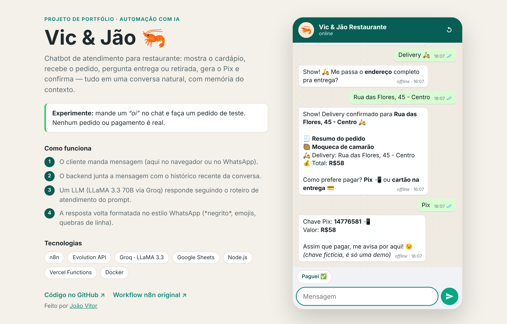
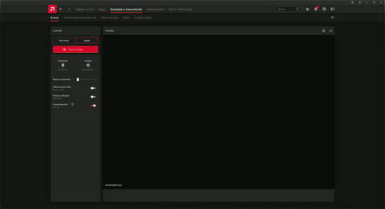
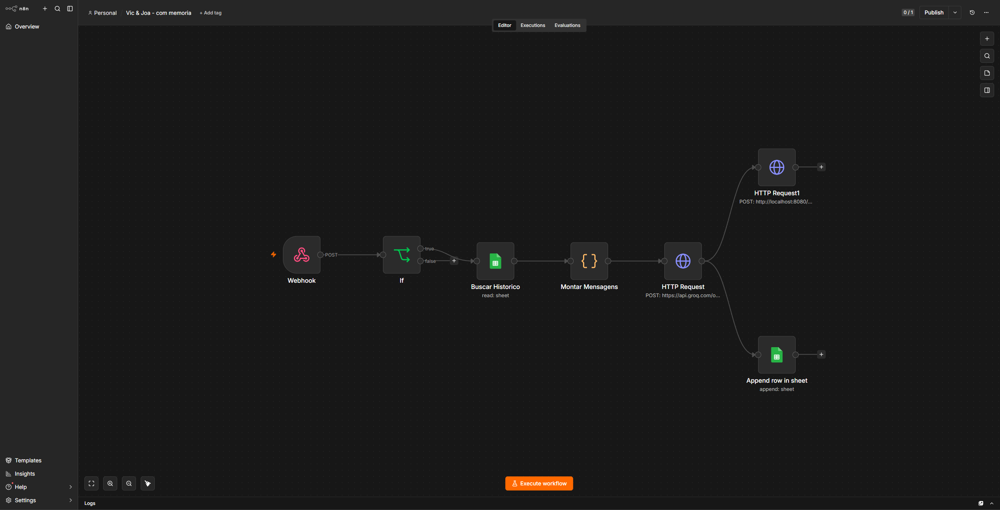

# 🍽️ Vic & Jão — Chatbot de Atendimento via WhatsApp com IA

    

> 🔗 **Demo ao vivo:** https://SEU-PROJETO.vercel.app — converse com o bot direto no navegador, sem precisar de WhatsApp.

## 💡 Qual problema resolve?

Restaurantes perdem tempo (e clientes) com atendimento manual via WhatsApp. Esse chatbot simula o atendimento completo de um restaurante — do cardápio à confirmação do pedido — de forma automática, guiado por IA e com memória de conversa.

## ✅ O que você consegue fazer

- Consultar o cardápio e escolher o prato
- Escolher entre delivery ou retirada
- Definir a forma de pagamento (Pix ou cartão) e confirmar o pedido
- Manter uma conversa natural, com a IA lembrando o contexto do atendimento

## 📱 Demonstração

**Versão web (demo pública)** — interface estilo WhatsApp que qualquer pessoa pode testar:



**Versão original no WhatsApp** (n8n + Evolution API):



## 🧱 Duas versões, o mesmo atendente

O projeto nasceu como um workflow do **n8n** rodando localmente e conectado a um WhatsApp real. Como isso depende do meu computador ligado e de um número de WhatsApp pareado, criei também uma **versão web hospedada na Vercel**, que reaproveita o mesmo prompt, cardápio e lógica de memória — assim qualquer pessoa consegue testar o bot a qualquer hora.

| | Versão web (demo) | Versão WhatsApp (original) |
|---|---|---|
| Canal | Chat no navegador, estilo WhatsApp | WhatsApp real via Evolution API |
| Orquestração | Função serverless Node.js (`/api/chat`) | Workflow n8n |
| IA | Groq · LLaMA 3.3 70B | Groq · LLaMA 3.3 70B |
| Memória | Últimas 12 mensagens da conversa | Últimas 6 trocas buscadas no Google Sheets |
| Registro | — | Cada interação salva no Google Sheets |
| Hospedagem | Vercel (grátis) | Local (Docker + n8n) |

### Fluxo da versão web

```
Navegador ──POST /api/chat──▶ Função serverless ──▶ Groq (LLaMA 3.3 70B)
   ▲   histórico recente        + prompt do atendente         │
   └──────────── resposta formatada (*negrito*, emojis) ◀─────┘
```

- O **prompt e a chave da API ficam só no servidor** — o navegador envia apenas as mensagens.
- O histórico é validado (papéis, tamanho, quantidade) e há **limite de requisições por IP** para proteger a cota da API.
- **Modo offline:** se a chave da Groq não estiver configurada, ou se a API falhar/atingir o limite, um atendente com respostas pré-programadas assume o mesmo roteiro. A demo nunca fica fora do ar (essas respostas aparecem marcadas como *offline*).

### Fluxo da versão WhatsApp (n8n)

1. Cliente envia mensagem no WhatsApp
2. Webhook do n8n recebe via Evolution API
3. O histórico de mensagens daquele cliente é buscado no Google Sheets, para o bot manter contexto da conversa
4. A mensagem atual + o histórico são enviados a um modelo de linguagem (Groq/LLaMA 3.3 70B), que segue um roteiro de atendimento definido via prompt
5. A resposta é enviada de volta ao cliente pelo WhatsApp
6. Cada interação é registrada automaticamente numa planilha do Google Sheets (data/hora, telefone, mensagem, resposta)



## 🛠️ Tecnologias utilizadas

- **n8n** — orquestração do fluxo de atendimento (versão WhatsApp)
- **Evolution API** — integração com WhatsApp (Docker)
- **Groq API (LLaMA 3.3 70B)** — geração das respostas do bot, com memória de conversa
- **Google Sheets API** — registro de conversas e fonte de histórico
- **Node.js + Vercel Functions** — backend da demo web, sem dependências externas
- **HTML, CSS e JavaScript** — interface estilo WhatsApp, responsiva e com tema escuro
- **Docker Compose** — containerização do Evolution API

## 📁 Estrutura do repositório

```
vic-e-jao-whatsapp-bot/
├── api/
│   └── chat.js                 # função serverless (Vercel) — POST /api/chat
├── lib/
│   ├── chat.js                 # validação do histórico + chamada à Groq
│   ├── prompt.js               # roteiro do atendente (mesmo do n8n)
│   ├── menu.js                 # cardápio e dados do restaurante
│   ├── fallback.js             # modo offline (respostas pré-programadas)
│   └── rate-limit.js           # limite de requisições por IP
├── public/                     # interface web estilo WhatsApp
│   ├── index.html
│   ├── styles.css
│   └── app.js
├── test/                       # testes (node --test)
├── n8n-workflows/
│   └── vic-e-jao-whatsapp-bot.json   # workflow exportado do n8n
├── docs/demo-web.png
├── server.js                   # servidor local de desenvolvimento
├── vercel.json
├── package.json
├── docker-compose.yml          # Evolution API (versão WhatsApp)
├── demo.gif
└── fluxo-n8n.png
```

## 🚀 Como usar

### Opção 1 — Demo web (recomendado)

**Rodar localmente** (Node.js 20.12+; não precisa instalar dependências):

```bash
git clone https://github.com/jvtdemiranda/vic-e-jao-whatsapp-bot.git
cd vic-e-jao-whatsapp-bot
cp .env.example .env   # coloque sua GROQ_API_KEY (opcional: sem ela roda no modo offline)
npm run dev            # http://localhost:3000
```

Testes:

```bash
npm test
```

**Publicar na Vercel (grátis):**

[](https://vercel.com/new/clone?repository-url=https%3A%2F%2Fgithub.com%2Fjvtdemiranda%2Fvic-e-jao-whatsapp-bot&env=GROQ_API_KEY&envDescription=Chave%20da%20API%20da%20Groq%20(console.groq.com%2Fkeys))

1. Crie uma chave gratuita em [console.groq.com/keys](https://console.groq.com/keys)
2. Na Vercel, importe este repositório (Add New → Project). Não precisa configurar build: a Vercel serve a pasta `public/` e a função `api/chat.js`
3. Em *Settings → Environment Variables*, adicione `GROQ_API_KEY` (e, se quiser, `GROQ_MODEL` para trocar o modelo)
4. Faça o deploy e coloque o link no topo deste README e no seu portfólio

### Opção 2 — Versão original no WhatsApp (n8n)

#### Pré-requisitos
- Docker e Docker Compose instalados
- Node.js (para rodar o n8n localmente)
- Conta na Groq (API key) e projeto no Google Cloud com Sheets API habilitada

#### Passos

1. Configure as variáveis de ambiente
```bash
cp .env.example .env
# edite o .env com sua chave real do Evolution API
```

2. Suba o Evolution API
```bash
docker compose up -d
```

3. Rode o n8n localmente
```bash
npx n8n start
```

4. Importe o workflow
- Acesse `http://localhost:5678`
- Vá em Workflows → Import from File
- Selecione [`n8n-workflows/vic-e-jao-whatsapp-bot.json`](./n8n-workflows/vic-e-jao-whatsapp-bot.json)
- Configure suas próprias credenciais (Groq, Evolution API, Google Sheets) dentro do n8n e troque `SEU_SHEET_ID` pelo ID da sua planilha

## 👨‍💻 Autor

João Vitor — [github.com/jvtdemiranda](https://github.com/jvtdemiranda)

## 📜 Licença

Distribuído sob a licença MIT. Veja [LICENSE](./LICENSE) para mais detalhes.
